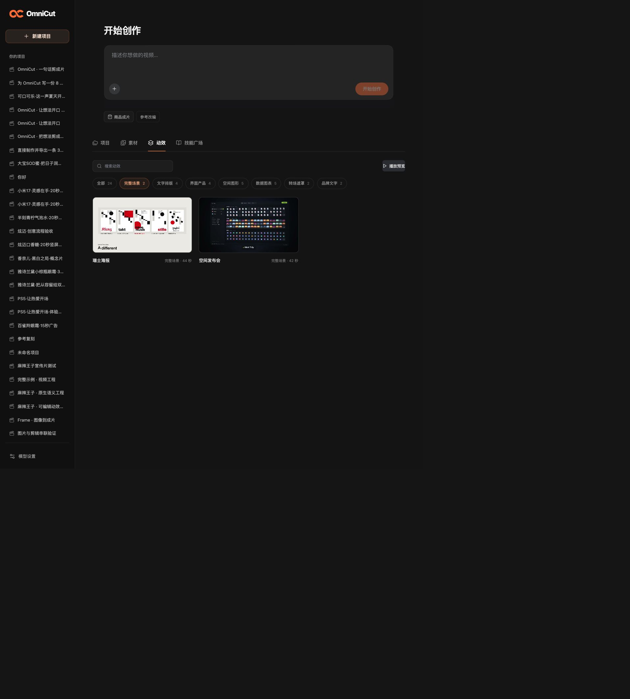
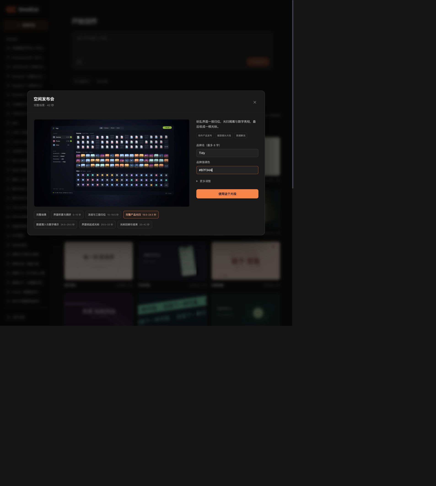

# 动效画廊与原生能力扩充

本轮把动效库作为可编辑、可复用的原生能力继续扩充：从公开样例中提炼字体、图形、数据与转场技巧，再用 OmniCut 现有 Author Package、Film、时间线和逐帧渲染接口实现。画廊里的预览与海报应来自本地实际渲染，每项展示用途和可改参数，方便浏览后加入工程。

这份文档记录调研依据、实现路线与真实验证边界。首轮新增 20 个基础包，加上已有的轻盈揭幕，共 21 项；这些基础包为自行实现。随后补入两套完整原作者场景，当前共 23 项内置动效，项目保存的组件另列。完整场景保真移植与实际 Agent 使用记录见下文。

## 首轮新增能力

| 分类 | 原生包 | 实际实现 |
| --- | --- | --- |
| 文字排版 | `kinetic-type`、`character-reveal`、`type-ribbon`、`outline-echo` | 大字侧向入场与形状构图、逐字位移/旋转/模糊、双向字带、多层描边错位 |
| 数据图表 | `number-roll`、`bar-chart`、`line-chart`、`ring-chart`、`flow-links` | 计数与刻度、错峰柱形生长、SVG 路径绘制、占比环、步骤连接线 |
| 界面产品 | `stagger-cards`、`phone-demo`、`product-spotlight`、`image-slices` | 错层卡片展开、手机微透视与内容滚动、产品聚光、图片分条揭示 |
| 空间图形 | `orbital-system`、`particle-trails`、`wireframe-depth`、`light-ribbons`、`grid-focus` | 轨道节点、点阵轨迹、投影线框、Canvas 曲线光带、网格焦点波 |
| 转场遮罩 | `mask-reveal`、`circle-transition` | 双幕横向打开与文字遮罩、圆形画面揭示 |

已阅读这 20 个独立 `render.js`，其布局、图形和时间驱动动作不同。它们属于首轮基础能力：当前代码没有实现参考中完整的闭式弹簧系统、同一对象跨多个场景的连续形变、真正的多图片 Bento 重排、中文点阵滚字或景深焦点变化。后续应按实际任务补这些能力，不把数量当作镜头表现力已全面达标。

## 调研如何转成我们的动效

先把一个成熟样例拆成独立动作：逐字错峰、遮罩揭示、连续形变、保持对象身份的布局切换、图表描线、遮挡转场、镜头推拉等。再为动作声明输入、可调范围、时间阶段、画幅适配和透明背景支持，最后接入已有原生组件体系。完整广告、特定品牌叙事和作者配乐不作为默认导入对象。

调研建议继续覆盖：点阵滚字、进度与完成态连续形变、滑块与标签指示器、虹膜遮挡、图片网格重排、商品焦点转换、几何编排和二维镜头。它们是从下列具体文件提炼的通用方向，其中部分尚未进入首轮组件，实际支持项以已落盘并完成验证的组件为准。

| 参考文件 | 可提炼的能力 | 实现判断 |
| --- | --- | --- |
| [逐字与品牌片头提示词](https://github.com/yihui-dev/awesome-opus5-5-videos/blob/main/prompts/techhalla-498547.md) | 单字独立运动、错峰、强调、短句构图 | 原生实现可调文字动效；不用原品牌文案 |
| [字形结构与遮罩提示词](https://github.com/yihui-dev/awesome-opus5-5-videos/blob/main/prompts/gdgtify-929495.md) | 字先读完再转形；不同字形通过遮挡衔接 | 长句需要分行和阅读停留，不能只追求速度 |
| [连续 UI 形变提示词](https://github.com/yihui-dev/awesome-opus5-5-videos/blob/main/prompts/twoclipping-402193.md) | 同一容器变形、前后沿不同弹簧、内容独立出入 | 拆成进度、标签、卡片等小组件 |
| [连续产品展示提示词](https://github.com/yihui-dev/awesome-opus5-5-videos/blob/main/prompts/twoclipping-496100.md) | 虹膜、全屏遮挡、网格展开、元素身份保持 | 先实现能独立用于时间线的转场和布局动作 |
| [二维镜头](https://github.com/Rieranthony/product-film-skill/blob/main/plugins/product-film/skills/product-film/templates/kit/camera.ts)、[闭式弹簧](https://github.com/Rieranthony/product-film-skill/blob/main/plugins/product-film/skills/product-film/templates/kit/spring.ts) | 绝对时间驱动、log 空间缩放、弹簧步响应叠加 | 数学能力可适配现有时间时钟；源仓 MIT |
| [Punctum 画面引擎](https://github.com/sundyme/punctum/blob/main/films/35-lights-social/16x9/assets/film.js) | 固定点阵、暗点、滚字扫描波、确定性 hash | 影片源码 MIT，字体 OFL；中文须另用可支持中文的字形来源 |
| [动态图表](https://github.com/yasinozmeen/animasyon-stil-katalogu/blob/main/stiller/veri/anim.html)、[几何编排](https://github.com/yasinozmeen/animasyon-stil-katalogu/blob/main/stiller/bauhaus/anim.html) | 路径按段长绘制、数字计数、网格对齐与形状节奏 | 未见 LICENSE，只作阅读参考后自行实现 |
| [粒子场核心](https://github.com/ishuagrawal/particle-beach/blob/main/js/core.js) | 点描材质、seeded RNG、共享参数、遮挡层次 | 源仓 MIT；大型模拟不能直接冒充绝对时间短组件 |

## 索引仓库的实际范围

2026-10-10 核查了公开 JSON 与完整文件树。

- [awesome-opus5-5-videos](https://github.com/yihui-dev/awesome-opus5-5-videos)：513 条作品/提示词记录，317 条为动效类别。513 个提示词 Markdown 中，279 条未标为部分提示，234 条为部分提示或原帖描述。仓内没有 HTML/JS/TS 动效实现或视频文件；技术标签表示重制效果的技术栈。仓库有 MIT，第三方影片、品牌、音乐和素材仍属于各自作者。
- [awesome-opus-5.5-video](https://github.com/zhuyansen/awesome-opus-5.5-video)：1427 条作品，367 条附提示词信息，其中完整提示词 150 条、简述 217 条；1060 条无提示词。只有 23 条非空资源外链，仓内没有动效源码或视频文件。仓库没有 LICENSE，README 明言收录不授予许可；模型归属按作者陈述，未独立复现。
- 追踪外链发现 [20 种风格合集](https://github.com/yasinozmeen/animasyon-stil-katalogu) 确有 20 个 HTML 实现、22 个 MP4 和 20 个 GIF，但无 LICENSE。[blueprint-animation](https://github.com/moguzbulbul/blueprint-animation/blob/main/LICENSE) 的许可证为 CC BY-NC 4.0，商业使用需要作者书面许可。

两个索引含有重叠原帖，不能把数量相加当作独立可导入能力。上表链接指向实际读取的提示词、实现与许可证文件；不把外部仓库快照放入产品库。

## 提示词与 Skill 应承担的任务

Agent 要能按场景目的选择真实可用组件，并知道文字、颜色、数据、节奏和画幅怎样调整。动效说明需包含用途、参数、输入限制和示例；制作提示词应写清动作关系与阅读顺序。复杂镜头可先指定焦点路径、遮挡时刻、文字入场/停留/出场和节拍映射，再进入实现。

工程要求应落到真实接口：全部视觉状态由绝对时间算出、随机种子固定、取帧不依赖前一帧、预览和导出共用实现。检查包括不同顺序取帧、文字裁切、对比、遮罩破损、对象衔接和循环首尾；音乐节拍是可选输入，静音状态也应能理解画面。

技能文档应引用我们的组件和验收工具，区分现有能力与需要新实现的镜头。第三方 Skill 中涉及下载、安装、上传、收费生成或发布的步骤应按本任务范围选择，不因阅读了文档就自动执行。

## 验证与局限

调研实际读取了公开索引、提示词与若干源码/许可证，未运行第三方代码，也未把原作者成片当成我们已复现的质量证据。

21 项内置组件均有来自隔离本地工程的实际原生预览与海报，`preview-source.json` 记录原生导入、SVML 源、构建 ID 和渲染参数。实际预览为 640×360、24 fps、4 秒、96 帧，重建脚本走已有 Hypit / Hyperframes 渲染链路，不调用收费生成服务。脚本位于 [build-motion-previews.mjs](../scripts/build-motion-previews.mjs)。

逐组查看了 21 张实际海报；新增 20 项的默认标题、对比和构图未见显著裁切或重叠。另查看了 9 个代表组件的各 8 张时间采样帧：大字、逐字、计数、曲线、圆形揭示、占比环、字带、线框和错层卡片。数值从 33、88、116 收敛到 128，环形百分数从 21、56、71 收敛到 76；曲线逐步绘制、末端点和数值出现，遮罩揭示和卡片动作也符合实现。

源码审查发现并促成修复：数值 0 被当空文案、空数据误作单个 0、逐字标题静默截断、长标题超出范围、短色值拼接透明度、圆形组件的透明背景失效、字带滚空/周期测量和曲线最后节点不显示。图表也移除了无效的运动幅度控件。调整后的默认预览已纳入上述检查。

产品界面已实际检查四列画廊、分类、搜索、暂停、详情编辑文案和加入创作输入框。数字参数的 HTML 步进基准曾拒绝合法默认值，现保留范围校验并调整为接受真实参数值。一次本机观察中，目录 API 约 13 ms，单个大字海报/视频请求约 4/3 ms；这只是该次本地观察，不是长期性能承诺。

额外用 [verify-motion-composition.mjs](../scripts/verify-motion-composition.mjs) 实际渲染了 6 秒竖屏组合：商品 PNG 与透明逐字叠层进入同一 Film，均从第 2 秒开始。真实代表帧确认图片与文字按局部时钟入场，透明层保留底片和商品。受控输入的 7 项像素检查通过；这只验证这两项组合，不代表所有竖屏构图均已验收。SVG 输入曾通过编译却在当前 provider 渲染时报不支持；PNG 输入已完成实际渲染，技能说明已记录这一边界。

海报和离散采样帧无法证明全部连续运动、音画同步或任意参数组合的商业成片质量。本轮完成的是默认 16:9 基础组件与画廊链路；尚未验证所有 9:16 布局、完整 60 fps 高分辨率输出、随机取帧逐像素一致或专业镜头语言的完整覆盖。参考里更复杂的弹簧、连续形变、点阵字形和焦点景深仍需进一步实现与验收。

## 完整场景移植（2026-10-10）

用户指出基础组件质感不足后，本轮采用 [Lemo-Opuscar](https://github.com/lemomo-ai/lemo-opuscar) 固定提交 `a75e2b3384cded87955c8743b5a59db06ea491a8` 的两套完整场景，保留作者的 film、相机、曲线、字体角色与镜头关系；未用 sceneKit 重写为简化近似版。

| 画廊名称 | 场景 | 已实现接法 |
| --- | --- | --- |
| 瑞士海报 | 44 秒；网格、大字、红圆、乐谱重排、海报墙 | 原生 `.track`；三种原字体 + 中文 fallback；标题/颜色；7 段可选源区间；`sourceStart / rate` |
| 空间发布会 | 42 秒；264 个对象、拉远、冻结归位、光扫、数字揭示、光标回响 | 原生 `.track`；三种原字体 + 中文 fallback；品牌/颜色/字幕；6 段可选源区间；`sourceStart / rate` |

两项均已由既有 Hypit / Hyperframes 原生渲染链路完整输出 960×540、24 fps 的预览（分别 1056 与 1008 帧），并实际查看代表帧与产品页面。预览的原参考音轨仅用于看原设计，用户改文案后的生产工程应单独编排声音；包中也保留纯配乐。字体 OFL、原代码 MIT 与音频来源分别记录在各包 LICENSE/CREDITS 中。

画廊支持点选并循环预览源片段，将其起点、结束、速率与目标时长传入创作请求。Agent 现可用 `list_motion_components` 查 scene/effect，`get_motion_component` 先只读场景接口，再 `use_motion_component` 获取 `sourcePaths` 与 `localBuild`。motion-direction 与 video-workspace 指导读取实际原场景、使用 typed 字体、裁取源时间并接入当前 Film；源码改动后调用 `rebuild_motion_component`，复用已有本地编译器，再提交和预览。品牌长度、非空与颜色约束在画廊提交前检查，避免将明显无效参数留到影片编译时才报错。

这些场景默认保留原作品内容；公开参数只覆盖说明的部分。全文本改编仍需要 Agent 改相关源模块，竖屏也需要重新编排，不能把横屏缩成竖屏后宣称设计已完成。没有对原视频做逐像素同帧比对，也没有宣称 Prompt Motion 的全部作品已经移植。

## 实际 Agent 复用验收

2026-10-10 从产品首页发起真实制作任务：制作 15 秒横屏 OmniCut 短片，前段表现界面从纷乱到归位，后段用海报排版收束品牌，中文、黑橙、纯配乐。观察者通过浏览器提交创作要求、催办与恢复提示，没有代写测试工程。

Agent 使用当前默认 Sonnet 高推理模型，自行 list → get → use 两套场景，读取实际原源码；修改中文内容与颜色、沿用原运动和字体，通过 `rebuild_motion_component` 重建两个包。最终裁取空间发布会源 14–22.5 秒，放在片内 0–8.5 秒；瑞士海报源 37.5–44 秒，放在片内 8.5–15 秒，均保留原速率。原字体和中文 fallback 作为真实 Font 输入，两个视觉 Track 与音乐 AudioTrack 接进同一 Film，提交后依据实际预览修正切点与片尾。

最终成片 `26ff9a25-3469-4b75-9a2e-8a123e765146` 已实际完成 450 帧导出：15 秒、1920×1080、30 fps、1 条非静音音轨。检查了原生预览和最终导出的代表帧，空间归位、光扫、海报墙及品牌片尾均保留。声音仅核对真实音轨、响度和峰值，未人工试听；技术导出成功不等同商业广告审美已经全面达标。没有调用新的图片、视频或声音生成服务，Agent 对话本身有模型用量。

本次并非一次无干预顺利完成：首轮约 11 分钟只读与规划，尚未写片，随后模型传输错误中断；服务恢复后，通过界面明确要求先出首版，第二轮约 14 分钟完成最终交付。期间还遇到恢复后的文件未读取保护与独立音轨只认识旧模板的问题；Agent 自行读取后恢复、沿原生音轨接法完成。产品层已补充本地重建入口与收敛指导，并修复使用既有 `clock / program.timeline` 的单 Film 代码工程可直接添加音轨。多 Film 无明确标记时仍需先指定目标。

结论：真实的源码改编、原生组合、预览与导出已经走通；执行效率仍不够理想。完整汉化还留下通知中的细小 `now`，竖屏重排与更多主题的选择质量尚未验收。画廊卡片优先播放精彩段，详情提供完整原场景与可选源片段。

